# SERK Construction OS 3.0 — Master Engineering Bible

> Extracted from the enclosed original DOCX. Original document controls if formatting or extraction differs.

SERK TECHNOLOGIES GROUP   /   PRODUCT & ENGINEERING

SERK
CONSTRUCTION
INTELLIGENCE OS

MASTER ENGINEERING BIBLE  /  VERSION 3.0

### Africa-first. Enterprise-grade. AI-led. Offline-resilient.

A unified operating system for capital projects, construction, infrastructure, engineering and real estate — from feasibility to asset operation.

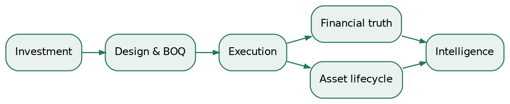

FIGURE 01  /  The integrated enterprise

15 NOVEMBER 2026  •  PROPOSED DESIGN BASELINE
Prepared for SERK engineering, product, construction and finance teams.

This is an engineering specification, not a claim of completed implementation, certified compliance or infinite physical capacity. All targets require validation.

## Reading map & governing decisions

Use this as the source of truth for the proposed platform; approved ADRs and requirements supersede illustrative examples.

I / Product  |  01–09: enterprise model, lifecycle, BOQ, scheduling, field, procurement, stock, fleet and workforce.

II / Controls  |  10–15: contract administration, finance, engineering, quality, real estate and document governance.

III / Technology  |  16–24: architecture, data, APIs, synchronization, scalability, retention, security, AI and integration.

IV / Assurance  |  25–29: deployment, observability, tests, delivery roadmap and reference material.

Baseline decisions  |  Go transactional core, PostgreSQL, offline SQLite/edge, React/TypeScript, Flutter, governed AI and cell-based growth. Validate against the existing repository before adoption.

Requirement vocabulary  |  MUST = mandatory; SHOULD = recommended; MAY = optional. Each MUST needs a traceable test and accountable owner.

Scope disclaimer  |  No exact earlier reference photographs are embedded: the chat displayed dynamically retrieved images without recoverable source files. Original technical figures and synthetic charts reconstruct their engineering meaning.

| Approval authority | Accountability |
| --- | --- |
| Product owner | Scope, adoption, prioritized requirements |
| Chief architect | ADRs, interfaces, scalability |
| Finance controller | Financial invariants and posting policies |
| Construction lead | QS, schedule, quality and field validation |
| Security lead | Threat model, privacy and release gates |

## Product ecosystem & benchmark

Capability targets, not claims of feature parity. Design for contractor, owner, engineer, government and infrastructure operators.

Strategic benchmark  |  RIB 4.0: estimating and 5D BIM; IFS Cloud: assets and service; CMiC: construction financials; Trimble Viewpoint/ProjectSight: office-field collaboration; SAP: enterprise controls; Primavera/Aconex: project controls and CDE; Procore and Autodesk: field and design coordination.

Product boundary  |  SERK COMMAND, CAPITAL, ESTIMATE, PLAN, BUILD, SUPPLY, STOCK, FLEET, PEOPLE, DESIGN, CONTRACT, ASSURE, ESTATE, CONNECT, SENTINEL and BRAIN share identity and data contracts.

Operating model  |  Tenant → group → legal entity → portfolio/program → project → site/zone → WBS → work package → activity; legal books stay independent of project hierarchy.

Tenant configuration  |  Feature flags, effective-dated policy, chart of accounts, unit catalog, calendar, country pack, approval authority and document templates.

Rollout  |  Contractor and owner pilots using controlled synthetic and then authorized historical datasets. Pilot names require organizational permission.

| Role | Outcome |
| --- | --- |
| CEO / board | Portfolio cash, forecasts and decisions |
| CFO / controller | Ledger, job cost, budget, reconciliation |
| Project director / PM | Scope, schedule, cost, risk, readiness |
| Site / QS / consultant | Evidence, quantities, certification |
| Supplier / client | Own orders, documents, valuations |

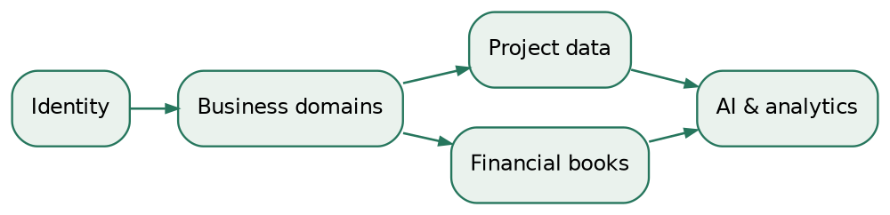

FIGURE 02  /  Shared platform

## Construction lifecycle & control gates

End-to-end state transitions with clear separation between operational events, commercial authorization and accounting.

Lifecycle  |  Feasibility → design → estimate → bid → award → mobilize → procure → execute → measure → certify → invoice → collect → handover → operate.

Baseline discipline  |  Freeze original contract, budget and schedule revisions; every subsequent authorized change records predecessor, delta, reason, approvers and effective date.

Work package release  |  Check current approved drawings, required permits, ITP, resource reservations, predecessor acceptance and competent staff. Emergency stop-work never requires internet.

State machine  |  Draft → submitted → reviewed → approved → effective → closed; rejected, superseded and cancelled states preserve history. No implicit state jumps.

Traceability  |  Origin IDs, revision IDs, actor, tenant, project, timestamp, correlation ID and source evidence travel across each workflow.

| Gate | Evidence required |
| --- | --- |
| Investment | Feasibility, funding, risk approval |
| Award | Signed contract, authority, BOQ revision |
| Mobilization | WBS, baseline, HSE readiness |
| Payment | Measurement, independent certification, deductions |
| Handover | As-built, defects, asset and warranty data |

FIGURE 03  /  Lifecycle

## Estimating, BOQ & tender engine

A deterministic quantity-and-rate engine with independently reviewed AI-assisted estimates.

Entities  |  EstimateRevision, BOQItem, QuantityTakeoff, RateBuildUp, ResourceRate, CrewTemplate, SupplierQuote, BidScenario. Store units and dimensions; reject incompatible unit conversions.

Rate calculation  |  Direct cost = materials + labor + equipment + subcontract; full cost = direct + allocated overhead + contingency + escalation. Selling rate = full cost / (1 − target margin). Never confuse markup and margin.

Price provenance  |  Every rate carries source, region, currency, FX date, unit, confidence, validity and approval. Freeze rates on bid submission; reprice only in a new revision.

Quantity import  |  Excel/CSV schema mapping, staged PDF extraction, IFC takeoff; reconcile item counts and totals; flag duplicate codes, missing units and ambiguous mapping.

Bid analysis  |  Compare methods, sensitivity to FX/inflation, supplier risk, lead times and cash curve. Tender access is confidential; AI never submits bids autonomously.

Acceptance  |  Golden tests cover decimals, rounding, wastage, resource composition, alternate rates, rejected units and identical results on repeated calculation.

| Resource / 1 m³ | ETB |
| --- | --- |
| Materials | 5,800 |
| Labor | 950 |
| Equipment | 650 |
| Direct cost | 7,400 |
| Overhead 10% | 740 |
| Full cost | 8,140 |
| Selling rate at 15% margin | 9,576.47 |

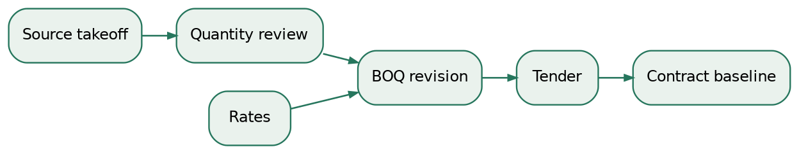

FIGURE 04  /  BOQ lineage

## Planning & project controls

Deterministic scheduling plus statistical forecast models; preserve baseline and status-date context.

CPM engine  |  Activities with calendars, duration, FS/SS/FF/SF links, lag, constraints. Detect cycles; compute early/late dates, total float and critical path. Handle calendars, holidays and time zones.

Resource leveling  |  Optimize labor and equipment under capacity, skills, site access, contractual dates and mobilization costs. Present feasible alternatives and trade-offs; never silently alter approved schedules.

Earned value  |  PV = planned budgeted work, EV = budgeted completed work, AC = actual cost. CPI = EV/AC; SPI = EV/PV; undefined denominators yield null, not zero.

Forecasting  |  EAC = AC + ETC. ETC includes remaining commitments and uncommitted future costs; do not double count. Monte Carlo outputs P50/P80 dates and documented distribution assumptions.

Progress discipline  |  Separate physically installed, measured, certified, billed and collected quantities. Use approved measurement rules and WBS weighting.

Acceptance  |  Schedule fixtures include cycles, parallel paths, lag, holidays, resource conflict, baseline revision and delayed delivery.

| Metric | Illustrative ETB million |
| --- | --- |
| PV / EV / AC | 100 / 90 / 96 |
| CPI / SPI | 0.9375 / 0.90 |
| Cost variance / schedule variance | −6 / −10 |
| ETC / EAC | 110 / 206 |

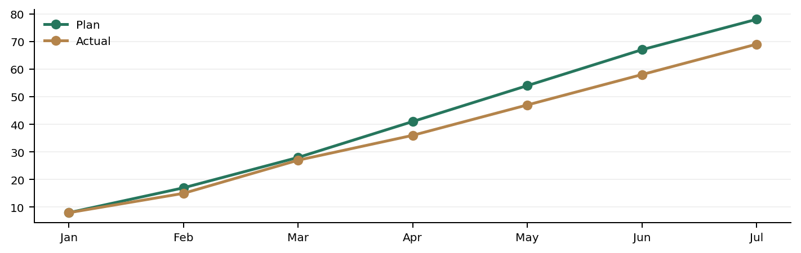

FIGURE 05  /  Planned vs actual progress — illustrative, not measured performance.

## Field execution & quantity surveying

Mobile-first, low-bandwidth, auditable progress capture with explicit authorization.

Daily report  |  Work package, shift, weather, crew, hours, machine hours, installed quantity, stoppages, location and photographs. Capture provenance and distinguish observed from estimated data.

Work readiness  |  Evaluate drawings, permits, predecessor completion, reservation, competency and inspection plan. Server revalidates releases; local stop-work is immediate.

Measurement book  |  Quantity line has BOQ revision, measurement method, station/chainage or location, drawing version, dimensions, units, evidence and sign-off.

Quantity balance  |  Cumulative approved measurement cannot exceed applicable scope without approved variation; corrections produce revision or reversal. Certification references specific accepted measurement lines.

Field UX  |  Today view, offline status, draft queue, sync conflict inbox, camera compression, searchable cached drawings, language toggle and printable daily report.

Safety  |  No AI-generated advice substitutes for approved method statements, structural judgment or competent engineer release.

| Record | Verification |
| --- | --- |
| Daily report | Supervisor review |
| Measurement | QS verification |
| Inspection | Authorized quality officer |
| Certified quantity | Consultant/contract-authority approval |
| Exception | Named reviewer and resolution |

FIGURE 06  /  Site evidence to accounts

## Procurement & subcontracting

Budget-aware, auditable source-to-pay with transparent supplier evaluation.

PR creation  |  Generate demand from work package/schedule; reserve stock first; record request purpose, delivery date and specification. Check available budget and authority before commitment.

RFQ and evaluation  |  Sealed quotes where applicable; normalize currencies, units, taxes, freight and terms. Record selection rationale and conflict-of-interest declarations.

Commitment  |  Approved PO creates commitment. Receipt relieves open quantity; invoice posting reconciles receipt accrual and remaining commitment using defined accounting policy.

Three-way match  |  Compare PO line, accepted receipt and invoice; tolerance per item/value with authorized exception. Duplicate supplier invoice number plus normalized fingerprint triggers review.

Subcontracts  |  Scope/BOQ, performance security, measured work, retention, insurance, deductions, claims and independent approval.

Imports  |  Track pro forma, FX, letters of credit, shipment, customs, freight and landed cost; allocate by configured value/weight/volume basis and reconcile.

| State | Control |
| --- | --- |
| PR submitted | Budget and stock check |
| PO approved | Maker-checker and commitment |
| Receipt accepted | Quality and quantity checks |
| Invoice posted | Three-way match |
| Payment settled | Verified bank and reconciliation |

FIGURE 07  /  Source-to-pay

## Inventory & material ledger

Perpetual quantity and value ledgers linked to work packages and warehouses.

Data model  |  Item, UnitConversion, Warehouse, Bin, Lot, Serial, StockMove, Reservation, Count, ValuationLayer. Source and destination locations; append-only posted movements.

Transaction rule  |  Lock or serialize inventory bucket (tenant, site, item, lot); verify available = on-hand − reserved; reject overissue unless approved controlled exception policy.

Valuation  |  Configured weighted average or FIFO subject to accounting review. Track purchase receipt, transfer, issue, return, scrap, count adjustment, landed cost and reconciliation.

Offline stock  |  Allocate bounded site/device reservations; provisional issues consume allocation locally. Central validation on sync, disputed transactions quarantined, no automatic negative stock.

Material intelligence  |  Compare BOQ theoretical quantity against actual issues and installation; detect waste, returns, abnormal cement age, fuel discrepancy and reinforcement cutting losses.

Acceptance  |  Concurrent issues, transfer in transit, duplicate receipt, lot expiry, returns, unit conversions, valuation rounding and GL control-account reconciliation.

| Movement | Quantity/value behavior |
| --- | --- |
| Receipt | Increase stock; receipt accounting |
| Transfer | Source decrease; destination increase/in transit |
| Issue | Decrease stock; project cost |
| Return | Reverse based on approved valuation |
| Count adjustment | Approved difference and journal |

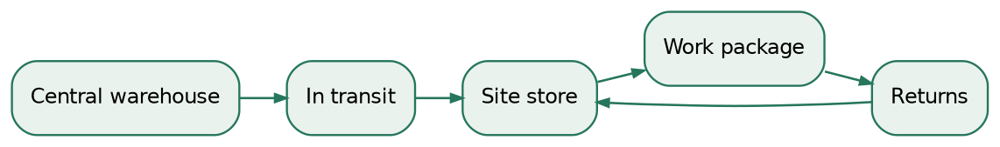

FIGURE 08  /  Stock movement

## Equipment, maintenance & telemetry

IFS-inspired lifecycle control, industrial telemetry and cost attribution.

Asset register  |  Asset ID, class, serial, purchase, warranty, depreciation policy, meter history, site, owner, operator and service intervals.

Machine economics  |  Cost per productive hour = attributable ownership + operating + maintenance cost divided by productive hours. Separate idle, breakdown and standby; allocate by approved project rules.

Maintenance  |  Work order, task checklist, labor, parts, downtime, permit, isolation, approval, meter-based due date, service history and vendor warranty.

Fuel  |  Fuel issue linked to dispenser, asset, operator, site, meter and stock move. Compare expected range against actual; investigate before alleging misuse.

Telemetry  |  MQTT/HTTPS gateway with per-device identity, schema validation, sequence, clock-quality, deduplication, buffering and anomaly review. No direct machine-control actions.

Prediction  |  Condition model estimates failure risk with uncertainty and data quality; qualified maintenance team decides inspections and release.

| Input | Derived indicator |
| --- | --- |
| Engine hours / productive hours | Utilization and idle share |
| Fuel liters / hours | Consumption intensity |
| Downtime / planned hours | Availability |
| Parts + labor | Maintenance cost per hour |

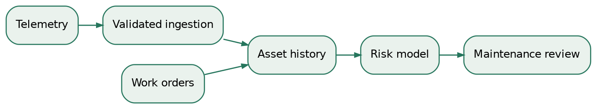

FIGURE 09  /  Asset intelligence

## Workforce, payroll & productivity

Construction-specific time and wage controls with privacy and human oversight.

Worker model  |  Employee/contractor, employment terms, wage basis, shift, skill, certification, assignment, allowance, deduction and pay account with access separation.

Time capture  |  Offline attendance, shift and timesheet approval; QR or device check-in where authorized. Detect overlapping shifts, impossible hours and missing supervisor review.

Payroll  |  Versioned jurisdiction rules; gross earnings, deductions, employer contributions, net pay and project allocation. Draft → review → approve → post → settle; reversal for corrections.

Cost allocation  |  Allocate labor by work package and cost code with approved timesheet distribution. Reconcile payroll subledger, bank file and GL.

Privacy  |  Minimize biometric/location data; legal review, limited access and purpose. No autonomous disciplinary or termination decisions.

Acceptance  |  Hourly, daily, salaried, overtime, leave, retroactive correction, split project, rounding and payroll-to-ledger reconciliation.

| Control | Outcome |
| --- | --- |
| Time approval | Verified work hours |
| Payroll preview | Employee and project totals |
| Independent approval | No self-approved payout |
| Posting | Balanced ledger and payable |
| Settlement | Bank reconciliation |

## Contracts, variations & IPC

Commercial controls for unit-price, lump-sum, cost-plus, design-build and EPC agreements.

Contract model  |  Agreement, signed revision, scope, schedule, obligations, payment terms, retention, securities, advance, notice deadlines, insurance, disputes and defects period.

Variation  |  Notice → proposal → valuation → technical/commercial review → authorization → baseline delta. Pending changes remain separate from approved contractual value.

IPC math  |  Current gross certified amount = cumulative accepted value minus prior certified gross. Apply current retention, advance recovery and other deductions under contract. Keep tax and prior corrections separate.

Claims  |  Evidence chronology, notice requirement, affected activities, causation, cost records and decision history. AI drafts analysis with clause citations; legal/contract professionals approve.

Revenue distinction  |  Certification, billing, cash collection and accounting revenue recognition are separate states. Apply relevant IFRS 15/local accounting policy after review.

Acceptance  |  Cumulative remeasurement, partial certification, negative adjustments, advance recovery, retention release and rejected duplicate quantity.

| Illustrative valuation | ETB million |
| --- | --- |
| Cumulative certified gross | 35.0 |
| Previous certified gross | 25.0 |
| Current gross | 10.0 |
| Retention 5% / advance recovery | 0.5 / 1.0 |
| Net before tax/other deductions | 8.5 |

FIGURE 10  /  Certification lineage

## Finance: authoritative accounting

Exact decimal arithmetic, double-entry invariants and reconciliation at the domain boundary.

Accounting model  |  LegalEntity, Book, FiscalPeriod, Account, Journal, JournalLine, Dimension, CurrencyRate, SourcePosting, AP/AR open item, BankStatement, Budget and Commitment.

Posting protocol  |  Validate actor, period, account and dimensions; lock source idempotency key; calculate exact amounts; verify balanced debit/credit by functional currency; insert immutable lines and outbox in one transaction.

Corrections  |  Posted records cannot be silently changed. Reversal/adjustment references original; closed-period posting rejected unless controlled reopening or approved adjustment period.

Commitment control  |  Budget available = approved control budget − actual cost − open commitments − other reserved amounts, without duplicate inclusion. Concurrency lock budget bucket before approval.

Financial reporting  |  Trial balance, balance sheet, income, cash flow, WIP, AR/AP aging, fixed assets, tax schedules and project profitability. Reconcile subledgers to GL and cash to bank.

Multi-currency  |  Record source currency, functional currency, exchange-rate ID, amount precision, rate policy and rounding account. Consolidation uses approved translation and elimination rules.

| Example event | Debit / credit (illustrative policy) |
| --- | --- |
| Receipt accepted | Inventory / goods-received-not-invoiced |
| Invoice matched | GRNI / accounts payable (variance separately) |
| Stock issued | Project WIP or cost / inventory |
| Supplier paid | Accounts payable / bank |
| Revenue recognized | Contract asset or receivable / revenue |

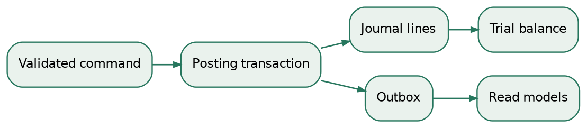

FIGURE 11  /  Finance atomicity

## BIM, GIS & digital twins

Open standards, versioned model mappings and evidence-backed field intelligence.

Interoperability  |  Support IFC 2x3, IFC 4 and IFC 4.3 ADD2 based on fixture compatibility; BCF issue exchange and IDS validation. Validate exact version and license requirements [R3].

Import pipeline  |  Upload → malware/size check → isolated parser → schema validation → geometry conversion → index → publish approved revision. Preserve original object and checksum.

Object identity  |  Use model revision + IFC GlobalId; handle missing, reused or changed IDs explicitly. Map objects to WBS, BOQ, activity, work package, inspections and asset tags.

5D  |  Quantity extraction retains unit, property path, method, model revision, exclusions and reviewer. 4D links approved schedule; cost changes need controlled mapping and version.

GIS  |  PostGIS spatial reference system, georeferenced survey, chainage, corridor, boundaries and location accuracy. Never assume coordinate systems or map elevations.

Digital twin  |  Sensor and imagery data are measured/estimated/reported/certified categories; human verification required for certified quantities and safety decisions.

| Versioned objects | Links |
| --- | --- |
| IFC model revision | Original file, hash, parser version |
| BIM object | GlobalId, properties, geometry |
| Mapping | BOQ, WBS, activity, asset |
| Issue | BCF topic, viewpoint, evidence |
| Asset | Commissioning, warranty, maintenance |

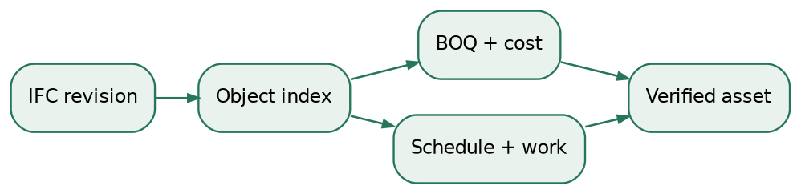

FIGURE 12  /  Model-to-asset

## Quality, safety & environment

Safety-critical controls belong to authorized professionals, not probabilistic models.

Quality plan  |  ITP, method statement, inspection types, acceptance criteria, hold/witness points, qualifications, sampling and document revision.

Lab  |  Sample chain of custody, batch/site, calibration record, test method, result, units, reference limits, pass/fail and authorized sign-off. Preserve failed tests.

NCR  |  Identify → isolate → investigate → disposition → corrective action → verification → close. No silent deletion of adverse evidence.

HSE  |  Permit to work, hazard assessment, toolbox talk, incident and near-miss, training, emergency action and regulatory reporting support. Stop-work is immediate offline.

Sustainability  |  Meter, fuel, waste, water, material and carbon activity records. Version emission factor source and geography; distinguish estimated values.

Acceptance  |  Test hold-point enforcement, expired calibration, missing permit, offline incident, independent closure and corrective-action history.

| Record | Evidence |
| --- | --- |
| ITP | Approved criteria and revision |
| Test | Sample, equipment, result, signature |
| NCR | Photos, disposition, verification |
| Incident | Restricted chronology and actions |
| Carbon estimate | Factor, unit, calculation and uncertainty |

## Real estate & asset operations

Developer and owner-side controls with segregated funds and full lifecycle traceability.

Development  |  Land parcel, feasibility, design phase, project funding, construction cost, unit inventory, area and unit pricing. Link unit and common-area cost allocation policy.

Sales  |  Reservation, sale agreement, payment schedule, installment, overdue status, transfer and refund approval. Prevent double reservation via atomic state change.

Restricted funds  |  Separate customer escrow/restricted balances where required; reconcile bank statements, approved disbursement and contract conditions. Legal review per jurisdiction.

Handover  |  Punch list, acceptance, documents, installed asset IDs, warranties, manuals and defects obligations. No certificate without required authorized sign-off.

Facilities  |  Service requests, preventive maintenance, service contracts, occupancy, utility readings, asset cost, SLA and renewal.

Management  |  Absorption, sales cash, cost per m², expected margin, receivables aging, unit availability and maintenance cost.

| Stage | Control |
| --- | --- |
| Reservation | Atomic unit availability |
| Contract | Approved terms and pricing |
| Installment | AR and bank reconciliation |
| Handover | Acceptance and asset data |
| Operation | Maintenance and warranty |

FIGURE 13  /  Development lifecycle

## Common data environment

Document control with immutable revision history and secure sharing.

Document model  |  Document ID, tenant/project, classification, revision, status, author, checksum, storage object, retention policy, signature, related entities and transmittal.

State  |  Work in progress → shared → published → archived; approve revisions, preserve superseded content, prohibit uncontrolled replacement.

Upload  |  Pre-signed scoped URL, content hash, MIME verification, size and decompression limits, malware scan, quarantine and isolated previews; no execute permission.

Export  |  Preview before print; logos, stamps, signature fields, QR verification and PDF/Excel generation with visible revision. A stamp image is not a cryptographic signature.

Search  |  Tenant/project ACL enforced before retrieval and snippets; derivative indexes receive revocations. Authorized export jobs produce manifest and short-lived link.

Retention  |  Legal hold, archival, subject-access workflow, deletion approvals and backup expiry. Signed records preserve verification evidence; do not promise perpetual personal-data retention.

| Document type | Owner |
| --- | --- |
| RFI / submittal | Engineering / consultant |
| PO / GRN | Procurement / stores |
| IPC / invoice | QS / finance |
| Drawing / model | Document controller |
| Handover package | Project manager |

FIGURE 14  /  Document pipeline

## Reference architecture & domain boundaries

Start with a modular transactional core. Separate compute-intensive or independently scaled services only when evidence justifies it.

Channels  |  React/TypeScript web, Flutter field app, partner portal and site-edge service. HTTPS API, OIDC identity, scoped tokens; gateway rate limits and request correlation.

Core  |  Go domain modules; application services enforce policy and state transitions. PostgreSQL is authoritative. Transactional outbox in same commit; durable event bus supports at-least-once delivery.

Supporting services  |  Object storage for documents/models; Redis for disposable cache; workers for file/BIM conversion; ClickHouse or read replicas for analytics; separate Python AI/optimization workers.

Deployment  |  Containerized workloads; managed PostgreSQL initially; Kubernetes only at justified scale. Separate control plane from tenant data cells; infra-as-code and environment isolation.

Domain ownership  |  No cross-domain table writes except explicitly owned transactional application services. Domain events versioned; query models are disposable, rebuildable and never authoritative.

Failure isolation  |  Timeouts, circuit breakers, bounded queues, retries with jitter, per-tenant rate limits and dead-letter handling; business actions never depend on AI availability.

| Layer | Candidate stack |
| --- | --- |
| Transaction / spatial | Go, PostgreSQL, PostGIS |
| Frontend / edge | React, Flutter, encrypted SQLite |
| Async / workflow | NATS JetStream or Kafka; Temporal when justified |
| AI / analytics | Python, pgvector, OR-Tools, ClickHouse |
| Identity / telemetry | OIDC, OpenTelemetry, Prometheus |

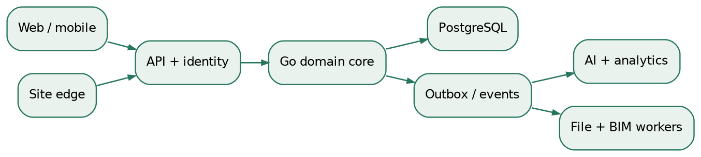

FIGURE 15  /  System topology

## Data model & transaction integrity

Relational constraints, exact numerics, scoped keys and auditable state transitions.

Key policy  |  Use UUID/UUIDv7 or equivalent globally unique IDs; tenant-scoped unique keys. Include legal_entity_id, project_id where relevant; composite foreign keys prevent cross-tenant reference leakage.

Temporal model  |  Persist UTC instants, local timezone and business dates; effective_from/to for business rules and master data; recorded_at for system history. Never infer event ordering solely from wall time.

RLS  |  Enable and force RLS for tenant-owned tables; API DB role cannot own tables or BYPASSRLS. SET LOCAL tenant context per transaction; pooled connections reset; verify jobs and exports equally.

Invariants  |  Journal balance, immutable posted lines, nonnegative available stock, approved quantity cap, unique source posting, closed periods and permission checks. Use controlled stored procedures or application transaction + deferred validation.

Concurrency  |  Lock aggregate/budget keys in consistent order; use optimistic revision or serializable transactions when needed; retry safe conflicts. No blind retries for irreversible external effects.

| Domain | Representative records |
| --- | --- |
| Project | project, wbs_node, activity, baseline |
| Commercial | contract, variation, measure, certificate |
| Supply | requisition, po, receipt, stock_move |
| Finance | journal, journal_line, open_item, budget |
| Governance | approval, audit_event, outbox, idempotency |

### Illustrative contract

CREATE UNIQUE INDEX source_once ON posting_source
  (tenant_id, source_type, source_id, posting_kind);
ALTER TABLE project ENABLE ROW LEVEL SECURITY;
ALTER TABLE project FORCE ROW LEVEL SECURITY;
CREATE POLICY tenant_scope ON project USING
  (tenant_id = current_setting('app.tenant_id', true)::uuid)
  WITH CHECK (tenant_id = current_setting('app.tenant_id', true)::uuid);
-- Illustrative only: role, project ACL, migrations and tests required.

## API, events & workflow protocols

Versioned REST contracts, durable event envelopes, idempotency and explicit state transitions.

HTTP API  |  /v1/projects/{id}/work-packages; /v1/purchase-orders/{id}/approve; /v1/journals/{id}/post. Use cursor pagination; limit page sizes; async jobs for large reports. OpenAPI specs and contract tests.

Write semantics  |  Idempotency-Key scoped to tenant, operation and authenticated principal; store request hash and result; reject key reuse with changed payload. If-Match/version for concurrent edits; 409 on conflict.

Event envelope  |  event_id, type, schema_version, tenant_id, aggregate_id, aggregate_version, occurred_at, correlation_id, causation_id, source_id and payload. Never put unrestricted personal data in bus messages.

Delivery  |  Outbox dispatcher retries; consumer inbox unique event ID, effect and inbox acknowledgement in one transaction; sequence gaps trigger reconciliation. Dead letters are visible and replay is authorized.

Workflow  |  Policy version, thresholds, actor roles, delegation, deadline, approval evidence. Separate preparation and authorization. On policy change retain original instance or explicitly migrate.

| HTTP result | Meaning |
| --- | --- |
| 201 / 202 | Created / accepted asynchronous job |
| 400 / 422 | Malformed / invalid business input |
| 401 / 403 | Unauthenticated / unauthorized |
| 409 / 412 | Conflict / version mismatch |
| 429 / 503 | Throttle / unavailable; retry guidance |

### Illustrative contract

POST /v1/purchase-orders/po_123/approve
Idempotency-Key: <unique-operation-id>
If-Match: "revision-7"
{ "decision": "approve", "policy_version": 12 }

Event: PurchaseOrderApproved.v1
{ "event_id": "<uuid>", "tenant_id": "<uuid>",
  "aggregate_id": "po_123", "aggregate_version": 8,
  "correlation_id": "<uuid>", "payload": { ... } }

## SERK EDGE: offline protocol

Offline operation is a core architecture, not a cached web page.

Device enrollment  |  Register hardware-backed keys where available; scoped authorization lease, expiry, tenant/project policy, device revocation. Encrypt SQLite and protected files; lock on inactivity.

Operation log  |  Client creates operation UUID, device ID, local sequence, base version, schema version, business date, payload hash and signature where supported. Commit local data + queue atomically.

Push  |  Batch by device sequence; server verifies identity, policy, integrity, idempotency and business invariants. Return accepted/rejected/conflict per op with authoritative record/version. Retry only unacknowledged operations.

Pull  |  Cursor-based delta feed filtered by current permission; use watermark and tombstones. Snapshot recovery if cursor too old; chunked attachment upload with hash and resumable offsets.

Conflict policy  |  Append-only evidence merge; versioned master records require explicit resolution; finance centrally posted; stock limited by reservation; revoked access quarantines pending data for authorized review.

Resilience  |  Test clock skew, lost device, long disconnection, app restart, expired authorization, duplicate/reordered operations and interrupted file upload. Local emergency safety instructions remain available.

| Offline class | Authority |
| --- | --- |
| Field notes / photos | Local capture; central validation |
| Stock issue | Bounded reserved quantities |
| Financial posting | Central authority only |
| Safety stop-work | Immediate local action |
| Contract change | Draft offline; central approval |

FIGURE 16  /  Synchronization protocol

## Scale without arbitrary product limits

No hard-coded limit on projects, transactions, users or years of business history. Capacity is physically finite and expanded through cells.

Control plane  |  Global tenant directory resolves tenant → home cell; each cell contains app instances, DB cluster, object storage namespace, event partitions and telemetry. Route by tenant, not user-supplied cell ID.

Placement  |  Start shared cells for small tenants; dedicate cells for large/regulatory tenants. Keep legal book and project consistency boundaries together; split very large tenant by approved business boundary only after architecture review.

Growth strategy  |  Scale reads with replicas, writers with tenant cells, hot tables with partitioning, analytics with independent projections. Scale workers by queue backlog; isolate noisy tenants via quotas and admission controls.

Partitioning  |  Range partition high-volume journals/events by time, optionally subpartition by tenant/hash when demonstrated. Preserve globally enforced idempotency using nonpartitioned registry or partition-key-aware uniqueness.

Cross-cell  |  No distributed financial transaction assumption. Use settlement/saga with explicit pending, failed and reconciled states for intercompany transfers; consolidated reporting via versioned read models.

Migration  |  Freeze/coordinate writes, snapshot and stream changes, verify checksums/counts/control totals, switch tenant routing with fencing token, keep rollback window and prevent dual writers.

| Growth tier | Illustrative benchmark objective — not a hard limit |
| --- | --- |
| T1 | 100 projects; 10M journal lines; 200 concurrent users |
| T2 | 1,000 projects; 100M lines; 2,000 users |
| T3 | 10,000 projects across cells; 1B lines across cells |
| Long-term | Expand cells and archives as capacity demands |

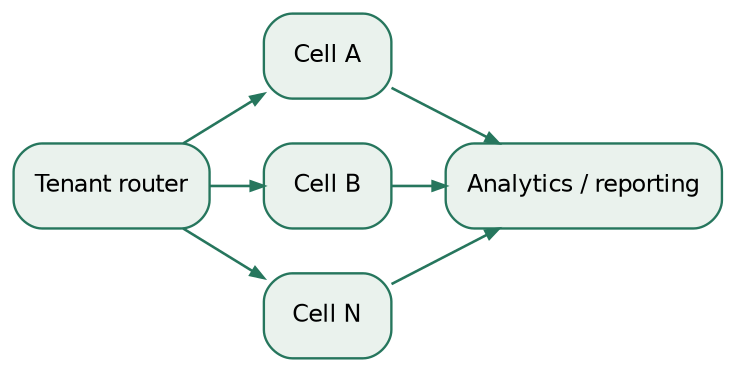

FIGURE 17  /  Cell-based architecture

## Unlimited history: data lifecycle

No arbitrary historical cutoff. Preserve authorized business history with tiered access, integrity verification and lawful retention.

Hot tier  |  Current operational partitions on high-performance relational storage; indexed latest working sets. Use cursor pagination, bounded queries, incremental materialized summaries and date filters.

Warm tier  |  Older but frequently queried partitions on lower-cost relational storage or read-only reporting clusters; preserve original IDs and schema version. Verify source-to-archive counts and financial totals.

Cold tier  |  Immutable archive objects (Parquet or equivalent plus original documents), manifest, SHA-256 checksums, encryption keys, schema and policy versions. Catalog indexed by tenant, time and record type.

Retrieval  |  Historical reports select hot/warm/cold by range; asynchronous archive reconstruction with explicit job status, evidence manifest and permissions. No silent exclusion of archived rows.

Preservation  |  Preserve financial documents and audit evidence according to legal/contract requirements and approved retention policy. Legal holds suspend deletion. Privacy erasure, retention expiry and backup expiry remain enforceable.

Continuity  |  Archive restore tests, integrity scrubs, schema conversion fixtures, key rotation with retained decryptability and documented exit/export formats. No dependence on proprietary storage for recovery.

| Tier | Design access target (to validate) |
| --- | --- |
| Hot | Interactive; p95 API target <300 ms at specified load |
| Warm | Interactive or asynchronous; seconds to minutes |
| Cold | Asynchronous, job-based; minutes to hours |
| Legal hold | Preserve required evidence regardless of normal expiry |

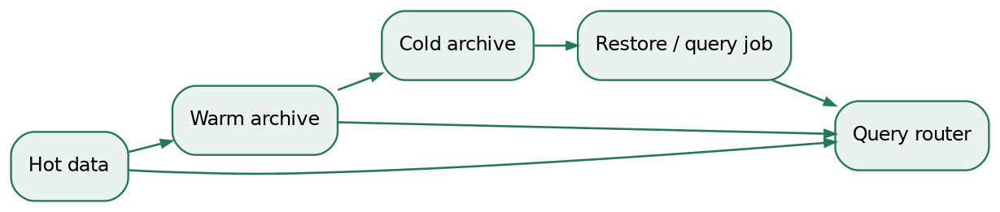

FIGURE 18  /  Lifecycle and retrieval

## Security & zero-trust controls

Defense in depth. Use OWASP ASVS 5.0 as a verification baseline [R2], with independent testing and tenant isolation.

Identity  |  OIDC, passkeys/MFA, short-lived access tokens, rotating refresh sessions, device/session revocation and scoped service identities. No shared privileged accounts.

Authorization  |  RBAC + ABAC: tenant, entity, project, role, amount, state and sensitivity. Deny by default. Maker-checker, no self-approval, independent verification for bank changes.

Data security  |  TLS, KMS-backed encryption, scoped storage URLs, field-level protection for bank/HR data, controlled key access, redacted logs and tenant-specific backups where required.

Audit  |  Append-only audit trail with actor, action, object, before/after or diff, policy decision, source IP/device, correlation ID and time. Hash chaining plus independently protected retention and periodic anchors.

Threats  |  Cross-tenant reads, IDOR, invoice fraud, insider misuse, ransomware, malicious files, prompt injection, leaked tokens, supply-chain tampering. Threat model every boundary.

Secure SDLC  |  SAST, dependency and secret scanning, SBOM, signed build artifacts, protected branches, reviewed migrations, DAST and independent penetration testing. Critical findings block release.

| Control plane | Enforcement |
| --- | --- |
| Gateway | Authentication, rate limit, WAF |
| Application | Permission and business policy |
| Database | RLS, constraints, no bypass role |
| Storage | Tenant prefix, access policy, encryption |
| Sentinel | Detection, alerts, incident response |

FIGURE 19  /  Defense in depth

## SERK BRAIN: governed AI architecture

Model-independent intelligence with retrieval, evidence, deterministic controls and human approval.

AI gateway  |  Provider adapters, model registry, routing by sensitivity/cost/quality, token budgets, redaction and consent. Approved local models for offline/private tasks. No direct production database access.

Retrieval  |  Filter by tenant, project, permission and document revision before embedding search; recheck on response. Treat retrieved documents as untrusted data, not instructions. Cite records and timestamps.

Agent runtime  |  Typed tool registry, least-privilege scopes, maximum tool calls, timeouts, execution budgets, approval tokens and audit. Read-only by default. Draft actions use ordinary business APIs.

Autonomy  |  L0 explain; L1 recommend; L2 draft; L3 preauthorized reversible action; L4 explicit approval. Never autonomously release safety work, certify engineering, transfer money or alter approved contract/ledger.

Predictive / optimization  |  Schedule Monte Carlo, cost forecasting, demand and equipment maintenance. Report assumptions, uncertainty, data coverage and drift. Optimize under hard business constraints.

Evaluation  |  Golden task sets, groundedness, retrieval ACL, refusal/abstention, prompt injection, model drift, tool-side authorization and red-team scenarios. Human review of consequential output.

| Agent family | Function |
| --- | --- |
| Executive / CFO / cost | Risk, cash, margin and variance |
| Estimator / tender / planner | Rates, bids, CPM and forecasts |
| Procurement / stock / fleet | Demand, waste, condition |
| QS / contract / quality | Draft measurement, notices, exceptions |
| Document / compliance / security | Retrieval, evidence and alerts |

FIGURE 20  /  Agent control loop

## African localization & integration

Versioned country packs, documented adapters, authorized data exchange and graceful degradation.

Country pack  |  Language, currency, calendar, time zone, tax, payroll, chart templates, statutory forms, procurement policies and document numbering. Rules have effective dates, approvals and test fixtures.

Ethiopia first  |  English, Amharic, Tigrinya and Afan Oromo; ETB, Gregorian/Ethiopian display; store canonical timestamps and convert using validated libraries. Legal and accounting review required before real processing.

Banking  |  Import statements via supported formats/API; verify payment beneficiary, dual approval, external idempotency/reference and reconciliation. Do not assume availability of local bank APIs.

CAD / schedule  |  IFC/BCF/IDS, controlled CSV/XLSX, Primavera/Microsoft Project adapters when licensed and technically supported. Preserve source versions and mapping errors.

Messaging  |  Email, Telegram, SMS and authorized WhatsApp connectors with consent, delivery logs and no sensitive disclosure in message bodies. Deep links require authentication.

Connector contracts  |  Credential vault, scoped permissions, schema/version, retry policy, rate limits, circuit breaker, dead letters, reconciliation, monitoring and revocation.

| Pack component | Example verification |
| --- | --- |
| Calendar | Round-trip test across leap days and year boundaries |
| Tax / payroll | Effective-dated jurisdiction golden cases |
| Language | Ethiopic fonts, search, RTL where applicable |
| Banking | Duplicate import and failed settlement |
| Privacy | Retention and data-subject request workflows |

## Deployment, observability & recovery

Production profiles should grow from simple managed cloud to dedicated and sovereign environments.

Profiles  |  Essential: managed single cell; enterprise: dedicated replicas, queue and search; sovereign/on-prem: approved local infrastructure, controlled updates and disaster recovery. Avoid unnecessary operational complexity.

Delivery  |  GitHub Actions, protected release branches, test and scan gates, signed images, infrastructure-as-code, staged environments and migration dry runs. Expand-contract migration for compatibility.

Observability  |  Structured logs, metrics, traces and audit separately. Correlation IDs; tenant-safe telemetry; monitor p95 latency, error rate, queue lag, DB locks, storage, sync failures, reconciliation and AI cost.

Recovery  |  PITR, encrypted offsite backup, immutable copies, documented RPO/RTO, periodic restore into isolated environment, consistency and ledger checks. Separate recovery for unsynced edge data.

SLOs  |  Proposed central 99.95% availability, RPO ≤5 min and RTO ≤60 min for critical data/services under agreed profile. Test failover, restore and regional outage; no unverified guarantees.

Runbook  |  Incident commander, severity, containment, rollback, reconciliation, communication and root-cause review. Financial recovery requires authorized accounting verification.

| Signal | Alert condition example |
| --- | --- |
| API | Error budget burn or sustained p95 breach |
| Database | Replica lag, lock waits, disk growth |
| Outbox | Oldest unprocessed event exceeds SLO |
| Sync | Rejected operations spike |
| Finance | Control-account reconciliation mismatch |

FIGURE 21  /  Delivery and recovery

## Verification & release gates

The release is evidence-driven. UI demonstrations and unit tests alone never establish production readiness.

Testing layers  |  Unit, property-based, integration, end-to-end, security, performance, concurrency, offline, migration, recovery, localization, BIM and AI evaluation. Use synthetic data first.

Load plan  |  Test T1/T2/T3 tiers, concurrent approvals and journal posting, 100M+ row partition scans, bulk imports, 10-year historical reports, archive restores and poor network conditions. Record hardware and dataset distributions.

Golden path  |  Tender → BOQ → budget → purchase → receipt → issue → actual cost → measurement → IPC → invoice → receipt → report. Reconcile operational and financial totals at every step.

Security gate  |  Independent security review; cross-tenant tests for every API, export, job, search and AI tool; resolve critical/high findings per approved risk policy.

Release gate  |  Domain owner acceptance, finance reconciliation, penetration test, load/DR evidence, support runbooks, monitoring, rollback and professional user acceptance.

Evidence  |  Requirement ID, commit SHA, environment, data fixture, expected/actual, result, timestamp, reviewer and artifact checksum. Failed or untested requirements remain visible.

| Requirement | Mandatory acceptance |
| --- | --- |
| FIN-001 | All journals balance; duplicate source cannot post |
| SEC-001 | Cross-tenant access denied at every boundary |
| INV-001 | Concurrent issues cannot overdraw stock |
| OFF-001 | Duplicate/reordered sync preserves one effect |
| ARC-001 | Archived data restores and reconciles |
| AI-001 | Agent cannot approve protected action |
| DR-001 | Restore satisfies agreed RPO/RTO |

## Engineering roadmap & pilot

Deliver complete vertical slices rather than 80 disconnected menus. Timelines are indicative and depend on resources.

First 90 days  |  Audit current repo and ADRs; identity/tenancy; projects/WBS/BOQ; controlled budget; purchase and stock; posting; field capture; reconciliation; recovery. Demonstrate one full golden path.

Months 3–9  |  Production-quality core construction ERP: estimates, project cost, procurement, inventory, finance, measurement, IPC and dashboards.

Months 6–15  |  Offline edge, scheduling, fleet, payroll, document governance and controlled pilots; verify cross-project and offline conflict behavior.

Months 12–27  |  BIM, contracts, quality, real estate, analytics, AI agents and optimization; independent validation and model evaluation.

Months 24–36  |  Cell expansion, archive automation, localization, implementation partners, sovereign deployment and mature support.

Pilot approach  |  Synthetic data → authorized historical data → limited real projects → expanded use. Suggested contractor and developer environments require their approval; maintain parallel reconciliation until sign-off.

| Workstream | Primary owner |
| --- | --- |
| Architecture / platform | Chief architect + platform lead |
| Construction workflows | Construction SME + product owner |
| Finance | Controller + finance domain lead |
| AI / data | AI lead + risk reviewer |
| Security / QA | Security lead + QA lead |

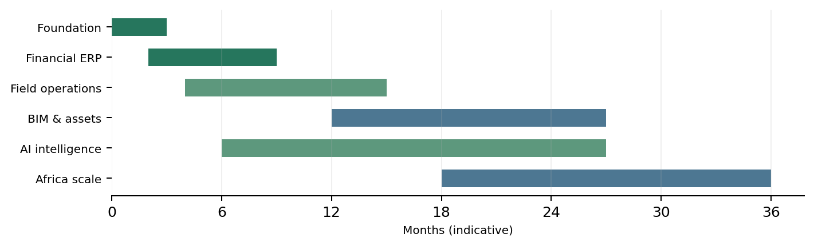

FIGURE 22  /  Indicative engineering roadmap.

## Functional module register

80 functional domains grouped by product. Each must be independently specified and tested before completion.

| Product / scope | Modules |
| --- | --- |
| COMMAND (5) | Enterprise, portfolio, program, strategy, executive intelligence |
| ESTIMATE (7) | CRM, feasibility, land, tender, BOQ, estimation, rate/bid analysis |
| PLAN / BUILD (9) | Budget, scheduling, resource, risk, work packages, site, QS, progress, engineering |
| DESIGN (3) | BIM, digital twin, GIS |
| SUPPLY / STOCK (9) | Procurement planning, purchasing, supplier, subcontract, inventory, warehouse, logistics, import, material controls |
| FLEET (4) | Equipment, fuel, maintenance, fixed assets |
| PEOPLE (5) | HR, attendance, payroll, productivity, competency |
| CONTRACT (4) | Contract, variation, claims, IPC |
| CAPITAL (9) | GL, AP, AR, project accounting, treasury, tax, consolidation, financial forecasts, audit |
| ASSURE (4) | Quality, lab, HSE, sustainability |
| CONNECT (13) | Document, drawings, RFI, submittals, correspondence, workflow, tasks, meetings, reporting, client portal, supplier portal, consultant portal, government portal |
| ESTATE (4) | Sales, facilities, commissioning, handover |
| BRAIN / SENTINEL (4) | Knowledge, AI orchestration, security, platform admin |

### Requirement card template

ID · domain · actor · preconditions · command · validation · data mutations · emitted events · exceptions · access policy · offline behavior · acceptance fixtures · metrics · evidence · owner · release status.

### Engineering definition of done

No placeholder workflows, mock totals presented as real, silent destructive actions, unsupported integrations or unverified production claims. Documentation and acceptance evidence must accompany implementation.

## Reference standards & decision log

Technical references are design inputs, not certification claims. Verify versions and licenses at implementation.

R1 PostgreSQL  |  Official documentation: partitioning, row security, backup and continuous archiving. https://www.postgresql.org/docs/current/

R2 OWASP  |  Application Security Verification Standard 5.0.0. https://asvs.owasp.org/

R3 buildingSMART  |  IFC 4.3 ADD2, BCF, IDS and openCDE standards server. https://standards.buildingsmart.org/

R4 IFRS  |  IFRS 15 Revenue from Contracts with Customers; apply only after professional assessment. https://www.ifrs.org/issued-standards/list-of-standards/ifrs-15-revenue-from-contracts-with-customers/

R5 NIST  |  AI Risk Management Framework, for governance and risk evaluation. https://www.nist.gov/itl/ai-risk-management-framework

Decisions pending  |  Existing codebase audit, accounting policy, cloud region/residency, data classifications, retention schedules, encryption architecture, country-pack review, benchmark budget and customer deployment agreements.

| ADR | Proposed decision / validation |
| --- | --- |
| 001 | Modular Go core; validate existing code and team fit |
| 002 | PostgreSQL authority + outbox; validate concurrency |
| 003 | Tenant cells; benchmark placement and migration |
| 004 | Tiered history; validate restoration and legal retention |
| 005 | Offline scoped leases; validate site conditions |
| 006 | AI gateway + human gates; evaluate tools and leakage |

## Command & posting specification

Detailed implementation contract for a journal posting vertical slice; pseudocode, not executable production code.

Preconditions  |  Authenticated principal, tenant and book membership, maker-checker approvals, open fiscal period, account/dimension validity, exact currency values and unique source identity.

Transaction  |  Begin; set local tenant; lock posting registry and accounting period; validate immutable approval version; compute lines; reject unbalanced totals; insert journal and lines; update subledger; insert audit/outbox; commit.

Failure  |  On validation failure return 422 with safe details; duplicate returns prior result; concurrent conflict retries with bounded jitter; if commit outcome unknown, resolve by idempotency key before retry.

Reversal  |  New authorized journal references prior journal and reverses applicable entries; preserve original values and period. Subsequent adjustment follows approved policy.

Reconciliation  |  Sum source postings vs journal totals, AP/AR control balances, stock valuation and bank reconciliation. Mismatch blocks close and creates incident.

### Illustrative contract

BEGIN;
SET LOCAL app.tenant_id = :tenant;
SELECT ... FROM fiscal_period FOR UPDATE;
-- validate state, approval, account, source, exact amounts
-- debit_total = credit_total in functional currency
INSERT INTO journal (...);
INSERT INTO journal_line (...);
INSERT INTO audit_event (...);
INSERT INTO outbox (...);
COMMIT;
-- Worker: publish idempotently; consumer inbox + effect atomic.

## Capacity engineering & storage economics

Sizing must use observed bytes, workload, replication, index overhead and retention policy, not marketing numbers.

Model  |  Annual rows = transactions/day × rows/transaction × active days. Raw bytes = rows × measured average row size. Physical storage includes indexes, WAL, replicas, backup and growth headroom; benchmark compression separately.

Illustration  |  1M business transactions/day × 6 lines × 365 = 2.19B lines/year. At hypothetical 300 bytes/line, raw rows ≈657 GB/year (decimal), excluding all overhead. A 10-year raw total ≈6.57 TB under same assumptions.

Performance  |  Measure write rate, write amplification, index hit rate, p95/p99, vacuum debt, checkpoint impact and lock contention. Test realistic skew; archive queries must not starve transaction workload.

Capacity trigger  |  Forecast 90-day demand; add capacity before SLO breach. Proposed signals: sustained disk >70%, queue lag, DB CPU saturation, growth rate and report latency. Tune thresholds with operators.

Cost governance  |  Meter compute, storage, archive retrieval, egress, AI tokens and support per tenant. Transparent quotas/rate limits protect fairness; never imply unbounded free resources.

| Test level | Synthetic data goal |
| --- | --- |
| 100M lines | Partition scans, posting, reconciliation |
| 1B lines across cells | Routing, aggregation, workload isolation |
| 10-year archive | As-of report and source reconciliation |
| Burst load | Backpressure and no duplicate postings |

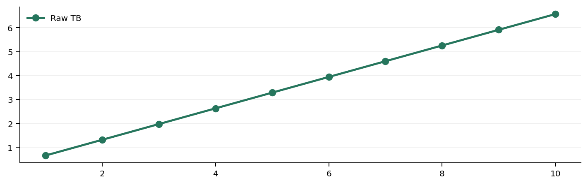

FIGURE 23  /  Illustrative raw line storage growth (TB) — illustrative, not measured performance.

## AI decision package & threat model

An agent output is an auditable proposal, not an authority.

Decision package  |  decision_id, tenant/project, question, evidence IDs, timestamps, model/provider/version, prompt template version, tool calls, assumptions, confidence/uncertainty, alternatives, expected impact, approval state.

Scenario  |  CFO agent detects cost overrun; planner traces delayed activity; procurement identifies missing material; resource agent proposes redeployment. Executive agent combines evidence; manager approves draft actions.

Injection defense  |  Retrieved files and web content are untrusted. Strip executable content, segregate instructions, use tool schema validation and deterministic policy checks. Never expose secrets or bypass retrieval ACL.

Data leakage  |  Tenant-scoped embedding index, no cross-tenant training by default, redaction, provider data agreements, log minimization and explicit external model routing permission.

Evaluation  |  Measure precision/recall for alerts, factual groundedness, abstention, outcome errors, tool permission violations, forecast calibration and cost. Use human-reviewed holdout datasets.

| Test | Pass criteria |
| --- | --- |
| Malicious RFI text | No instruction execution or data disclosure |
| Unauthorized project | No retrieval or answer leakage |
| Payment instruction | Draft or deny; no transfer |
| Missing evidence | Abstain or disclose uncertainty |
| Model unavailable | Core operations continue |

## Operational reporting & dashboards

Role-specific views with explicit metric definitions, data freshness and drill-down.

CEO  |  Portfolio revenue forecast, EAC, margin, liquidity, schedule risk, overdue decisions, utilization. Show source time, excluded data, forecast assumptions and responsible owners.

CFO  |  Daily bank position, 13-week cash forecast, AP/AR aging, WIP, committed cost, tax deadlines and close status. Cash forecast scenarios separate certified/billed/collected amounts.

PM  |  WBS progress, readiness, planned vs actual, material constraints, labor, equipment and cost variance. Drill down to underlying authorized transactions and evidence.

Access  |  Dashboard cache keys include tenant, user/role, policy version and scope; invalidate on permission changes. Exports preserve filters, as-of date and metric version.

Simplicity  |  Forest/ivory/graphite visual system, accessible contrast, keyboard navigation, language and offline status. No decorative graph presented as verified performance.

| Illustrative project financials | ETB million |
| --- | --- |
| Contract + approved variation | 260 |
| Actual cost | 82 |
| ETC | 134 |
| EAC | 216 |
| Forecast profit / margin | 44 / 16.9% |

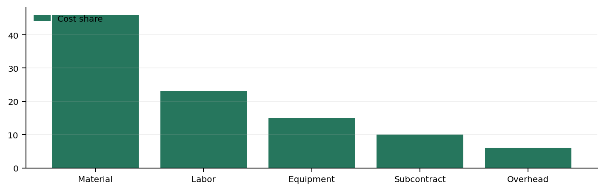

FIGURE 24  /  Example project cost categories (percent) — illustrative, not measured performance.
